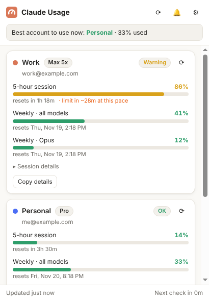
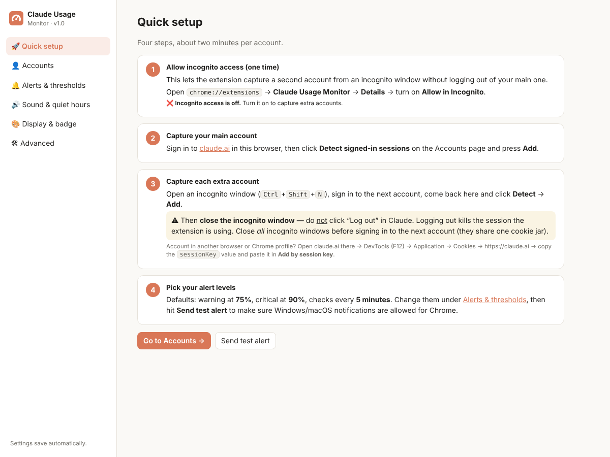
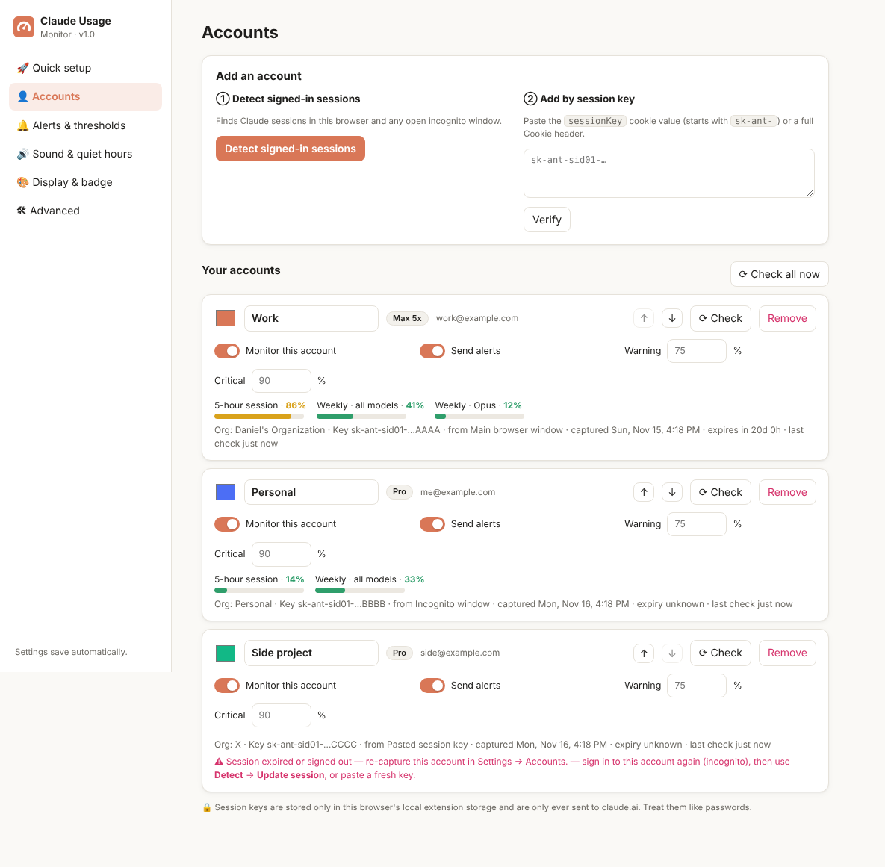

<div align="center">


# Claude Usage Monitor

**Monitor the usage limits of several Claude accounts at the same time, and get notified before any of them runs out.**




</div>

---

## Table of contents
- [Why](#why)
- [Features](#features)
- [Installation](#installation)
- [Adding your accounts](#adding-your-accounts)
- [Settings reference](#settings-reference)
- [How it works](#how-it-works)
- [Privacy & security](#privacy--security)
- [Permissions](#permissions)
- [Troubleshooting](#troubleshooting)
- [Project structure](#project-structure)
- [Known limitations](#known-limitations)
- [Contributing](#contributing)
- [License](#license)

---

## Why
If you use more than one Claude account, the only way to see how close each one is to its limit is to sign in to each account and open **Settings → Usage**. This extension checks every account in the background and shows them all side by side. It warns you as one approaches its limit and tells you which account to switch to.

## Features

### 📊 Multi-account dashboard (popup)
- One card per account, with bars for the **5-hour session**, **weekly (all models)**, **weekly Opus** and **weekly Sonnet** limits
- How long until each limit resets
- A **pace projection**: "limit in ~28m at this pace", based on recent usage
- A **"Best account to use now"** banner: the account with the most room left
- **Session details** for each account: email, name, organization and ID, plan and tier, billing type, masked session key, where and when it was captured, when the session expires, last checked, last successful check, and the thresholds in effect
- Refresh one account or all of them, and copy an account's details to the clipboard

### 🔔 Alerts
| Alert | When it fires |
|---|---|
| Warning | Usage crosses the warning threshold (default **75%**) |
| Critical | Usage crosses the critical threshold (default **90%**). Can stay on screen until dismissed |
| Limit reached | Usage hits **100%** |
| Pace alert | You're on track to hit 100% within *N* minutes (default 30) |
| Repeat reminder | Usage stays above a threshold (optional, every *N* minutes) |
| Available again | A limit resets and the account drops back below warning |
| Session problem | An account's session expired, or its checks failed 3 times in a row |

Every alert names the best alternative account, for example *"Switch to Personal (14% used)"*. Each alert has **Open Claude** and **Snooze 1 hour** buttons.

### 🔊 Sound & quiet hours
- Four built-in tones (chime, soft, beep, alert) with a volume slider. Tones are generated in the browser, so no audio files are bundled.
- Quiet hours with start and end times. Critical alerts can optionally still come through.
- Snooze alerts for 30 min, 1 h, 3 h or until 8:00 AM, or pause monitoring entirely.

### 🎛 Per-account controls
Label, color, monitoring on/off, alerts on/off, separate warning and critical thresholds, organization picker (for accounts that belong to several organizations) and display order.

### 🧩 Other
- Toolbar badge showing your choice of: highest usage, lowest usage (best account available), or number of accounts above warning. It shows `!` on errors and `II` when paused.
- Light, dark or system theme; 12- or 24-hour time; compact layout; sort accounts by your order, usage or name
- Export and import settings. Session keys are **excluded** unless you choose to include them.
- Debug log and a full reset

## Installation

> The extension isn't on the Chrome Web Store. Install it as an unpacked extension.

1. **Download** this repository: **Code → Download ZIP** (then unzip it), or clone it:
   ```bash
   git clone https://github.com/<your-username>/claude-usage-monitor.git
   ```
2. Open `chrome://extensions` (Edge: `edge://extensions`).
3. Turn on **Developer mode** (top-right toggle).
4. Click **Load unpacked** and select the `claude-usage-monitor` folder.
5. Open the extension's **Details** page and turn on **Allow in Incognito**. You need this to add extra accounts.
6. Pin the extension: click the puzzle icon, then the pin.

The setup guide opens automatically the first time.



**To update:** run `git pull` (or download the ZIP again), then click ↻ on the extension card in `chrome://extensions`.

## Adding your accounts

Open **Settings → Accounts**.

| Account | Steps |
|---|---|
| **Main account** (signed in to claude.ai in your normal window) | **Detect signed-in sessions** → **Add** |
| **Each extra account** | Open an incognito window (`Ctrl/Cmd + Shift + N`) → sign in at claude.ai → back in Settings click **Detect** → **Add** → **close the incognito window** |
| **Account in another browser or Chrome profile** | Open claude.ai there → `F12` → **Application** → **Cookies** → `https://claude.ai` → copy the **`sessionKey`** value → paste it into **Add by session key** → **Verify** → **Add** |

> [!IMPORTANT]
> **Don't click "Log out"** in Claude for an account you're monitoring. Logging out invalidates the session the extension uses. Close the incognito window instead.
> Close **all** incognito windows before you sign in to the next account. Incognito windows share one cookie jar.

**Session expired?** Sign in to that account again (in incognito), then click **Detect** → **Update session for "…"**, or paste a fresh key.



## Settings reference

<details>
<summary><b>Alerts & thresholds</b></summary>

| Setting | Default | Description |
|---|---|---|
| Warning at | 75% | First heads-up |
| Critical at | 90% | Urgent alert |
| Alert when limit is reached | On | Alert at 100% |
| Limits to watch | 5-hour, Weekly, Opus, Sonnet on; *Other* off | Choose which limit types count. *Other* covers limit types Claude adds later |
| Desktop notifications | On | Master switch |
| Notify when a limit resets | On | "Available again" alert |
| Pace alert | 30 min | Alert when the projection says you'll hit 100% within this time. 0 = off |
| Repeat reminders | 0 (off) | Alert again every *N* minutes while above a threshold |
| Suggest best alternative | On | Adds "Switch to X" to alerts |
| Keep critical alerts on screen | On | Critical alerts stay until dismissed |
| Alert on expired sessions & errors | On | |
| Check every | 5 min | 1–120 minutes |
| Check when Chrome starts | On | |
| Pause all monitoring | Off | |
</details>

<details>
<summary><b>Sound & quiet hours</b></summary>

| Setting | Default |
|---|---|
| Play a sound | On |
| Tone | Chime |
| Volume | 60% |
| Quiet hours | Off (22:00 – 07:00) |
| Critical alerts still come through | On |
</details>

<details>
<summary><b>Display & badge</b></summary>

| Setting | Default | Options |
|---|---|---|
| Badge shows | Highest usage | Highest usage · Lowest usage · Accounts above warning · Nothing |
| Show `!` on errors | On | |
| Theme | Match system | System · Light · Dark |
| Time format | 12-hour | 12-hour · 24-hour |
| Sort accounts by | My order | My order · Highest usage · Name |
| Compact layout | Off | |
| Show pace projection | On | |
| Expand session details by default | Off | |
</details>

<details>
<summary><b>Advanced</b></summary>

| Setting | Default | Description |
|---|---|---|
| Request mode | Automatic | *Automatic* tries a direct request and falls back to an open claude.ai tab if it's blocked. *Direct* only. *Through tab* only |
| Usage value scale | Percent | Switch to *Fraction* if bars show ~1% when real usage is high |
| Keep history for | 48 hours | Used for pace projections |
| Debug logging | Off | Records every check and the raw responses |
| Export / Import | — | JSON backup. Session keys are excluded unless you tick the box |
</details>

## How it works

```
┌──────────────┐  every N min   ┌────────────────────────┐   per-request cookie   ┌─────────────┐
│ chrome.alarms│ ─────────────▶ │ background service      │ ─────────────────────▶ │  claude.ai  │
└──────────────┘                │ worker (background.js)  │  (one-off DNR rule)    │  /api/...   │
                                └───────────┬────────────┘ ◀───────────────────── └─────────────┘
                                            │ usage JSON
                     ┌──────────────────────┼───────────────────────┐
                     ▼                      ▼                       ▼
             chrome.storage.local    notifications + sound     toolbar badge
                     │
                     ▼
              popup / settings
```

1. Each account is identified by its claude.ai **`sessionKey`** cookie.
2. On each check, the worker calls the same internal endpoint the claude.ai **Settings → Usage** page uses: `GET /api/organizations/{orgId}/usage`.
3. A short-lived `declarativeNetRequest` session rule attaches **only that account's** cookie to **only that request**, using a unique query tag. The rule is removed right after. Your normal browsing session is never changed.
4. If claude.ai's anti-bot protection blocks the direct request, *Automatic* mode reruns the request from inside an open claude.ai tab.
5. Results, a short history (for pace projections) and alert state are stored in `chrome.storage.local`.

Account details come from `GET /api/organizations` (organization, plan and tier) and `GET /api/account` (email and name).

## Privacy & security
- **No servers, no analytics, no third parties.** The extension only talks to `claude.ai`.
- Session keys are stored **unencrypted** in this browser's local extension storage (`chrome.storage.local`, not synced). **Anyone with a session key can use that account. Treat keys like passwords.**
- Exports leave out session keys by default. `.gitignore` excludes exported backups (`claude-usage-monitor-*.json`) so they don't get committed by accident.
- To remove everything: **Settings → Advanced → Remove all accounts & reset settings**, or uninstall the extension.

## Permissions
| Permission | Why |
|---|---|
| `storage` | Save accounts, settings and history |
| `alarms` | Run scheduled checks |
| `notifications` | Show desktop alerts |
| `cookies` | Read the `sessionKey` when you click **Detect** |
| `declarativeNetRequest` | Attach the right account's cookie to each usage request |
| `offscreen` | Play alert sounds |
| `scripting` | Fallback: run the request inside an open claude.ai tab |
| `https://claude.ai/*` | The only site the extension talks to |
| `"incognito": "spanning"` | Detect accounts signed in to an incognito window |

## Troubleshooting
| Problem | Fix |
|---|---|
| **"Blocked by claude.ai protection"** | Open any claude.ai tab and click ⟳. If it keeps happening: Advanced → Request mode → *Through an open claude.ai tab* |
| **"Session expired"** | Sign in to that account again (incognito) → **Detect** → **Update session** |
| **Detect finds nothing in incognito** | Turn on **Allow in Incognito** in `chrome://extensions` |
| **No notifications appear** | Allow Chrome notifications in your OS. Windows: Settings → System → Notifications → Google Chrome. macOS: System Settings → Notifications → Google Chrome. Then use **Send test alert** |
| **Bars look tiny** | Advanced → Usage value scale → *Fraction* |
| **Anything else** | Advanced → turn on Debug logging → click ⟳ → **Show log**, then open an issue with the log (remove personal info first) |

## Project structure
```
claude-usage-monitor/
├── manifest.json        # MV3 manifest
├── background.js        # service worker: polling, API, alerts, badge, account capture
├── shared.js            # defaults, parsing, formatting, projection helpers (ES module)
├── popup.html/.css/.js  # toolbar popup dashboard
├── options.html/.css/.js# settings + setup guide
├── offscreen.html/.js   # synthesized alert sounds
├── styles.css           # shared design tokens (light/dark)
├── icons/               # 16/32/48/128 px
└── docs/screenshots/
```
No build step and no dependencies. Edit a file, then click ↻ in `chrome://extensions`.

## Known limitations
- Relies on claude.ai's **internal, undocumented API**. If Anthropic changes it, checks fail with a clear error instead of showing wrong numbers. Please open an issue if that happens.
- Covers claude.ai subscription limits only, not Anthropic API (Console) credit or usage.
- Session keys expire over time (expiry is shown when known), so you'll need to re-capture an account occasionally.
- Chromium browsers only (Chrome, Edge, Brave, Arc). Firefox is not supported.

## Contributing
Issues and pull requests are welcome.
1. Fork and create a branch: `git checkout -b feature/my-change`
2. Load the folder unpacked and test your change
3. Open a PR describing what changed and why

## License
[MIT](LICENSE)

---

<sub>This is an unofficial, community project. It is not affiliated with, endorsed by, or supported by Anthropic. "Claude" is a trademark of Anthropic. Use it in line with Anthropic's terms of service.</sub>
